# Database

PostgreSQL 16 + Prisma. Mã nguồn schema đầy đủ: [[database-prisma-schema]] (người dùng, khóa học, tiến độ) và [[database-prisma-schema-exam-ai]] (kiểm tra, AI). Đây là **thiết kế đích đầy đủ**; `backend/prisma/schema.prisma` được **tạo dần theo từng phase** (xem bảng ngay bên dưới).

```mermaid
erDiagram
  TOPICS ||--o{ COURSES : "topic_id (phân loại)"
  USERS ||--o{ COURSES : "teacher_id (phụ trách)"
  USERS ||--o{ ENROLLMENTS : ghi_danh
  COURSES ||--o{ ENROLLMENTS : co
  COURSES ||--o{ MODULES : gom
  MODULES ||--o{ LESSONS : chua
  USERS ||--o{ LESSON_PROGRESS : hoan_thanh
  LESSONS ||--o{ LESSON_PROGRESS : co
  COURSES ||--o{ EXAMS : co
  MODULES |o--o{ EXAMS : "module_id (NULL = cuối khóa)"
  EXAMS ||--o{ QUESTIONS : gom
  QUESTIONS ||--o{ OPTIONS : co
  USERS ||--o{ ATTEMPTS : thuc_hien
  EXAMS ||--o{ ATTEMPTS : co
  ATTEMPTS ||--o{ ANSWERS : gom
  QUESTIONS ||--o{ ANSWERS : ve
  OPTIONS ||--o{ ANSWERS : chon
  COURSES ||--o{ AI_DOCUMENTS : co
  USERS ||--o{ AI_DOCUMENTS : tai_len
  LESSONS |o--o| AI_DOCUMENTS : "lesson_id (tùy chọn)"
  USERS ||--o{ AI_MESSAGES : dat
  COURSES ||--o{ AI_MESSAGES : ve
```



## Trạng thái áp dụng thực tế & lịch migrate theo phase
Đã áp dụng: **P01** (`users`) và **P02** (`p02_catalog`, khi đó chủ đề còn là cột cố định `courses.topic`). **P02b** (`topics`, [[adr-018-dynamic-topics]]) đang chờ migration — xem [[database-migration-topics]]. Mỗi phase khi cần model mới thì thêm vào `schema.prisma` và chạy **một migration** (`npm run prisma:migrate -- --name pXX_<slug>`, do Tech Lead chạy). Không sửa migration đã áp dụng.

| Phase | Enum / model thêm vào `schema.prisma` | Trường quan hệ ngược thêm vào model **đã có** | Trạng thái |
|---|---|---|---|
| P01 | enum `Role`, `UserStatus`; model `User` (chỉ cột scalar) | — | ✅ Đã áp dụng |
| P02 | enum `CourseStatus`, `ContentType`, `ExamStatus`; `Course`, `Module`, `Lesson`, `Enrollment`, `Exam`, `Question`, `Option` | `User.coursesTaught`, `User.enrollments` | ✅ Đã áp dụng (`p02_catalog`; `courses.topic` cố định — được thay ở P02b) |
| P02b | model `Topic`; **đổi** `Course.topic` (String) → `Course.topicId` + quan hệ `Restrict` | `Topic.courses` ↔ `Course.topic` (không đổi `User`) | ⬜ Chờ migration `p02b_topics` |
| P03 | `LessonProgress` | `User.lessonProgress`, `Lesson.progress` | ⬜ |
| P04 | enum `DocStatus`; `AiDocument` | `User.aiDocuments`, `Course.aiDocuments`, `Lesson.aiDocument` | ⬜ |
| P05 | `Attempt`, `Answer` | `User.attempts`, `Exam.attempts`, `Question.answers`, `Option.answers` | ⬜ |
| P08 | `AiMessage` | `User.aiMessages`, `Course.aiMessages` | ⬜ |

**Cách thêm model theo phase**: chép model từ [[database-prisma-schema]] / [[database-prisma-schema-exam-ai]]; **bỏ** mọi trường quan hệ trỏ tới model chưa tồn tại (ví dụ ở P02, `Lesson` chưa có `progress`/`aiDocument`; `Course` chưa có `aiDocuments`/`aiMessages`); ở phase sau thêm lại đúng các trường theo bảng. Trường quan hệ dạng list không tạo cột mới nhưng vẫn cần khai báo để Prisma Client truy vấn được.
> Nếu schema `User` thực tế khác KB (tên cột, phiên bản Prisma), Tech Lead sửa tài liệu cho khớp và ghi vào [[OPEN_QUESTIONS]] Q-15.

## 15 bảng
| Bảng | Khóa chính | Ghi chú |
|---|---|---|
| `users` | `id uuid` | `email` unique (lưu lowercase); `student_code` unique, nullable |
| `topics` | `id` | **+** `color`, `icon`; `name` và `slug` unique; `is_active`, `display_order` (ADR-018) |
| `courses` | `id` | FK `teacher_id → users`; FK `topic_id → topics` (**Restrict**, NOT NULL) |
| `modules` | `id` | FK `course_id` (cascade) |
| `lessons` | `id` | FK `module_id` (cascade); **+** `duration_seconds`, `file_public_id` |
| `enrollments` | `(user_id, course_id)` | `completed_at` null cho đến khi hoàn thành |
| `lesson_progress` | `(user_id, lesson_id)` | |
| `exams` | `id` | `module_id` null ⇒ cuối khóa |
| `questions` | `id` | |
| `options` | `id` | **+** `position` (0–3) |
| `attempts` | `id` | `UNIQUE(exam_id, student_id, attempt_no)` |
| `answers` | `id` | `UNIQUE(attempt_id, question_id)`; chỉ lưu câu đã trả lời |
| `ai_documents` | `id` | **gộp** bảng `documents`; **+** `lesson_id`, `file_public_id`, `error_message` |
| `ai_messages` | `id` | **+** `sources jsonb` |
| *(Chroma)* | — | vector nằm ngoài Postgres |

Mọi thay đổi so với Đồ án đánh dấu **+** được lý giải ở [[delta-vs-thesis]] (D-01…D-10).

## Chỉ mục (tối thiểu)
| Bảng | Chỉ mục |
|---|---|
| `users` | `email` (unique), `student_code` (unique) |
| `topics` | `name` (unique), `slug` (unique), `(is_active, display_order)` |
| `courses` | `teacher_id`, `(status)`, `topic_id` |
| `modules` | `(course_id, position)` |
| `lessons` | `(module_id, position)` |
| `enrollments` | PK + `course_id` |
| `lesson_progress` | PK + `lesson_id` |
| `exams` | `course_id`, `module_id` |
| `questions` / `options` | `(exam_id, position)` / `(question_id, position)` |
| `attempts` | `exam_id`, `student_id`, unique ba cột |
| `answers` | `attempt_id` |
| `ai_documents` | `course_id`, `uploaded_by`, `lesson_id` (unique) |
| `ai_messages` | `(user_id, course_id, created_at)` |

## Ràng buộc bổ sung (SQL thô trong migration đầu tiên)
```sql
ALTER TABLE exams    ADD CONSTRAINT exams_pass_score_chk CHECK (pass_score BETWEEN 0 AND 10);
ALTER TABLE exams    ADD CONSTRAINT exams_duration_chk   CHECK (duration_minutes BETWEEN 1 AND 300);
ALTER TABLE attempts ADD CONSTRAINT attempts_score_chk   CHECK (score BETWEEN 0 AND 10 AND correct_count <= total_questions);
ALTER TABLE options  ADD CONSTRAINT options_pos_chk      CHECK (position BETWEEN 0 AND 3);
ALTER TABLE topics   ADD CONSTRAINT topics_color_chk     CHECK (color IS NULL OR color ~ '^#[0-9A-Fa-f]{6}$');   -- P02b
-- Mỗi câu hỏi có đúng 1 đáp án đúng (đảm bảo bằng chỉ mục unique từng phần):
CREATE UNIQUE INDEX options_one_correct_per_question ON options (question_id) WHERE is_correct;
```

## Quy ước
- Cột `snake_case` (`@map`), bảng số nhiều (`@@map`); thời gian `timestamptz`; `uuid` mặc định `gen_random_uuid()` (Prisma `@default(uuid())`).
- Xóa cascade chỉ dùng cho quan hệ **sở hữu** (khóa→module→bài…). `answers → questions/options` và `attempts → exams` dùng **Restrict** để không mất lịch sử.
- Email chuẩn hóa lowercase ở service trước khi ghi/so khớp.
- Không dùng soft-delete (YAGNI). `topics.is_active` là **cờ hiển thị**, không phải soft-delete: chủ đề ẩn vẫn tồn tại và vẫn được khóa tham chiếu ([[concept-topics]]).

## Truy vấn tổng hợp quan trọng
Xem [[concept-exam-statistics]] (thống kê bài), [[concept-enrollment-progress]] (tiến độ), [[concept-admin-users-dashboard]] (dashboard).
