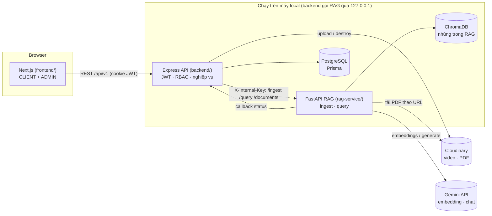

# Kiến trúc tổng thể

## Nguyên tắc cốt lõi
1. **Backend là cổng duy nhất** xác thực JWT, kiểm quyền, và đọc/ghi PostgreSQL & Cloudinary. FE **không** gọi RAG/Cloudinary-admin trực tiếp.
2. **RAG service** chỉ làm AI: không biết người dùng, không đọc Postgres. Backend phải kiểm quyền **trước** khi gọi.
3. **Hợp đồng REST nhỏ gọn** giữa Backend và RAG ([[api-internal-rag]]).
4. **Contract-first**: schema zod ở `backend/src/types/` là nguồn sự thật cho FE/BE/mock; FE dùng bản copy qua `sync-types.sh` ([[adr-016-manual-type-sync]]).
5. **UI-first**: FE dựng bằng mock adapters trước, đấu API sau ([[adr-015-ui-first-mock-adapters]]).

## Quyền sở hữu dữ liệu
| Dữ liệu | Chủ sở hữu | Nơi lưu |
|---|---|---|
| Người dùng, khóa học, bài kiểm tra, kết quả, tiến độ, `ai_documents`, `ai_messages` | Backend | PostgreSQL |
| Vector + metadata đoạn tài liệu | RAG | ChromaDB (volume `rag_data`) |
| Video/PDF | Backend (qua Cloudinary) | Cloudinary |

## Ba luồng nghiệp vụ chính
| Luồng | Đặc tả | Sơ đồ gốc |
|---|---|---|
| Làm bài kiểm tra | [[concept-exam-scoring-attempts]] | Hình 3-5, 3-8 |
| Nạp tài liệu PDF | [[concept-rag-ingestion]] | Hình 3-3, 3-6 |
| Hỏi đáp AI | [[concept-rag-query]] | Hình 3-4, 3-7 |

## Tổng hợp công nghệ
| Lớp | Công nghệ |
|---|---|
| Frontend | Next.js (App Router) · TypeScript · Tailwind CSS |
| Backend | Node.js · Express · TypeScript · Zod · Prisma |
| CSDL | PostgreSQL (Prisma) · ChromaDB (vector) |
| RAG | Python · FastAPI · pypdf · google-genai SDK · chromadb |
| AI | Gemini (dòng Flash + Gemini Embedding) |
| File | Cloudinary |
| Auth | JWT (cookie httpOnly) · bcrypt |
| Hạ tầng dev | npm; chạy trực tiếp 3 tiến trình + PostgreSQL cài trên máy ([[architecture-deployment-env]]); Docker tùy chọn ở Phase 10 |
| Kiểm thử | Vitest · Supertest · Playwright · pytest |

Vì sao chọn từng thứ: xem thư mục `03_DECISIONS` ([[adr-001-nextjs-app-router]] … [[adr-015-ui-first-mock-adapters]]).
