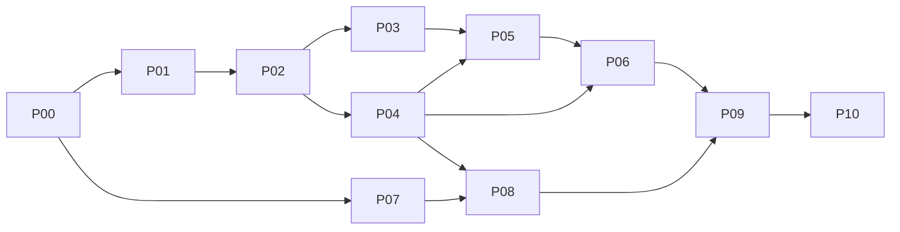

# Kế hoạch thực thi

## Cách chia
Dự án chia theo **lát cắt dọc nghiệp vụ** (mỗi phase = một nhóm màn + API + BE), không chia theo tầng. Mỗi phase chạy 3 bước của [[workflow-solo-dev]]: **1. Code UI & Wire API → 2. Code Backend (+DB) → 3. Tech Lead tự test**. RAG (Python) là làn riêng, độc lập UI.

| Phase | Tên | Màn | Endpoint (số) | Cỡ |
|---|---|---|---|---|
| [[plan-phase-00-foundation]] | Nền móng & spike rủi ro | — | health | M |
| [[plan-phase-01-auth]] | Xác thực & phân quyền | C01, A00 | 5 | S |
| [[plan-phase-02-course-catalog]] | Danh mục & ghi danh (+ P02b: chủ đề động) | C02, C03, C04 | 5 | M |
| [[plan-phase-03-learning-progress]] | Học tập & tiến độ | C05, C08 | 5 | M |
| [[plan-phase-04-admin-content]] | Admin: khóa học, chủ đề & soạn bài + upload | A02, A03, A09 | 22 | L |
| [[plan-phase-05-exam-student]] | Làm bài & kết quả (SV) | C06, C09 | 5 | M |
| [[plan-phase-06-exam-admin-stats]] | Admin: bài kiểm tra & thống kê | A04, A07, A08 | 13 | L |
| [[plan-phase-07-rag-service]] | Dịch vụ RAG (Python) | — | 5 nội bộ | L |
| [[plan-phase-08-ai-chat-and-docs]] | Tài liệu AI + Chat AI | A05, C07 | 7 + callback | L |
| [[plan-phase-09-admin-dashboard-users]] | Dashboard & Người dùng | A01, A06 | 4 | S |
| [[plan-phase-10-hardening-release]] | Hoàn thiện, bảo mật, demo | — | — | M |

**Chủ đề động ([[adr-018-dynamic-topics]], 2026-11-21)**: DB + `GET /topics` + chỉnh Client làm ở **P02b** (mục `P02-T`); CRUD chủ đề ở **P04** (màn A09). Tổng endpoint công khai: 60 → 66.

Cỡ: S ≈ 1–2 ngày · M ≈ 3–5 ngày · L ≈ 5–8 ngày (một dev, tham khảo, hiệu chỉnh sau Phase 01).

## Đồ thị phụ thuộc

P07 (RAG) không có UI nên có thể làm xen kẽ khi cần.

## Cột mốc demo
| M | Sau phase | Có thể trình diễn |
|---|---|---|
| M1 | P03 | SV đăng ký → duyệt → học → tiến độ (GV tạo bằng seed) |
| M2 | P06 | GV soạn khóa + đề; SV thi; GV xem thống kê |
| M3 | P08 | Tải PDF → hỏi AI có nguồn |
| M4 | P10 | Toàn hệ thống + demo script |

## Quy ước ID tác vụ
`P<phase>-<số>` (ví dụ `P02-5`) theo thứ tự làm trong từng file plan.

## Quy tắc chung mọi phase
1. Agent chỉ code + cập nhật log; **Tech Lead tự test** (bước 3) và đặt ✅ Đã test ([[agent-rules]], [[testing-strategy]]).
2. Hợp đồng đổi ⇒ cập nhật tài liệu + `backend/src/types/` + chạy `./sync-types.sh` **trước** ([[adr-016-manual-type-sync]]).
3. Hết phase: cập nhật [[PROGRESS]], FILE_MAPPING ([[FILE_MAPPING]], [[FILE_MAPPING_ADMIN]]).
4. Rủi ro/nợ kỹ thuật ghi ở PROGRESS; câu hỏi ghi [[OPEN_QUESTIONS]].
