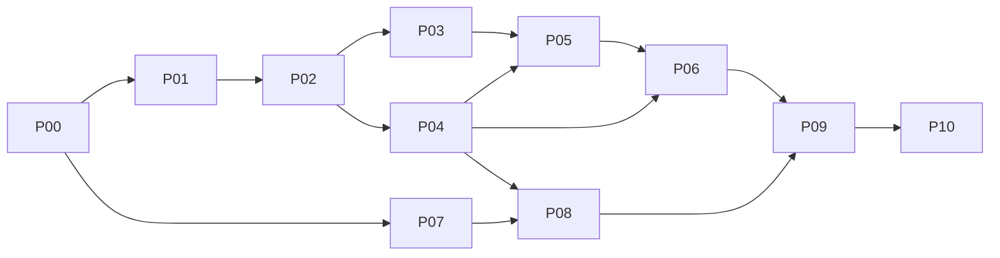

# Kế hoạch thực thi

## Cách chia
Dự án chia theo **lát cắt dọc nghiệp vụ** (mỗi phase = một nhóm màn + API + BE), không chia theo tầng. Mỗi phase chạy 5 giai đoạn **A→E** của [[workflow-ui-mock-wire-backend]]. RAG (Python) là làn riêng, độc lập UI.

| Phase | Tên | Màn | Endpoint (số) | Cỡ |
|---|---|---|---|---|
| [[plan-phase-00-foundation]] | Nền móng & spike rủi ro | — | health | M |
| [[plan-phase-01-auth]] | Xác thực & phân quyền | C01, A00 | 5 | S |
| [[plan-phase-02-course-catalog]] | Danh mục & ghi danh | C02, C03, C04 | 4 | M |
| [[plan-phase-03-learning-progress]] | Học tập & tiến độ | C05, C08 | 5 | M |
| [[plan-phase-04-admin-content]] | Admin: khóa học & soạn bài + upload | A02, A03 | 17 | L |
| [[plan-phase-05-exam-student]] | Làm bài & kết quả (SV) | C06, C09 | 5 | M |
| [[plan-phase-06-exam-admin-stats]] | Admin: bài kiểm tra & thống kê | A04, A07, A08 | 13 | L |
| [[plan-phase-07-rag-service]] | Dịch vụ RAG (Python) | — | 5 nội bộ | L |
| [[plan-phase-08-ai-chat-and-docs]] | Tài liệu AI + Chat AI | A05, C07 | 7 + callback | L |
| [[plan-phase-09-admin-dashboard-users]] | Dashboard & Người dùng | A01, A06 | 4 | S |
| [[plan-phase-10-hardening-release]] | E2E, bảo mật, demo | — | — | M |

Cỡ: S ≈ 1–2 ngày · M ≈ 3–5 ngày · L ≈ 5–8 ngày (một dev, tham khảo, hiệu chỉnh sau Phase 01).

## Đồ thị phụ thuộc

## Làn song song (nếu có ≥ 2 người/Agent)
| Làn | Chuỗi |
|---|---|
| **FE** | P00 → P01-A → P02-A → P03-A → P04-A → P05-A → P06-A → P08-A → P09-A |
| **BE** | P00 → P01-D → P02-D → P03-D → P04-D → P05-D → P06-D → P08-D → P09-D |
| **RAG** | P00 → P07 (độc lập) → ghép P08 |
Điều kiện: FE chạy mock nên **không chờ BE**; BE bám hợp đồng nên **không chờ UI**. Hai bên gặp nhau ở giai đoạn C/E.

## Cột mốc demo
| M | Sau phase | Có thể trình diễn |
|---|---|---|
| M1 | P03 | SV đăng ký → duyệt → học → tiến độ (GV tạo bằng seed) |
| M2 | P06 | GV soạn khóa + đề; SV thi; GV xem thống kê |
| M3 | P08 | Tải PDF → hỏi AI có nguồn |
| M4 | P10 | Toàn hệ thống + demo script |

## Quy ước ID tác vụ
`P<phase>-<giai đoạn><số>` ví dụ `P02-A3` (phase 2, giai đoạn A, việc 3). Dùng ID này trong commit/PROGRESS. Riêng Phase 00 dùng `P00-BE<n>` / `P00-FE<n>` (Nhóm A Backend / Nhóm B Frontend).

## Quy tắc chung mọi phase
1. Trước khi vào giai đoạn D của tính năng, **Review gate (B) đã Approved**.
2. Hợp đồng đổi ⇒ cập nhật tài liệu + `backend/src/types/` + chạy `./sync-types.sh` **trước** ([[adr-016-manual-type-sync]]).
3. Hết phase: cập nhật [[PROGRESS]], FILE_MAPPING ([[FILE_MAPPING]], [[FILE_MAPPING_ADMIN]]).
4. Rủi ro/nợ kỹ thuật ghi ở PROGRESS; câu hỏi ghi [[OPEN_QUESTIONS]].
